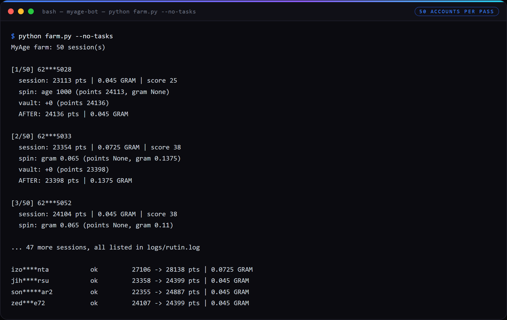
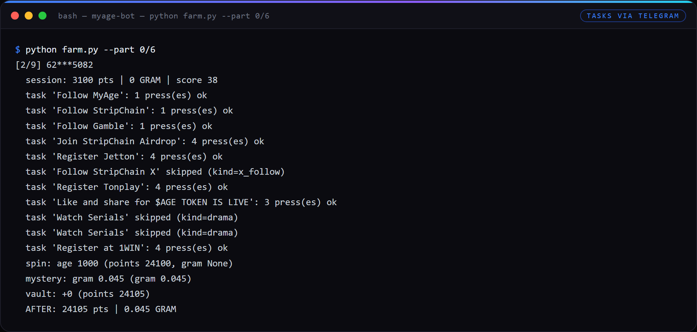

# My Age Bot

> Automated Telegram Mini App farming bot by **Layer Airdrop ID (LYID)**

Bot untuk **My Age** (`@MyAgeApp`) — Telegram Mini App yang membayar $AGE dan $GRAM berdasarkan
umur akun Telegram. Bot mengambil `initData` setiap akun secara otomatis lewat MTProto (tanpa buka
browser, tanpa copy manual), lalu mengerjakan seluruh loop harian: klaim Telegram check, tasks,
daily reward, spin, mystery spin, dan vault — untuk banyak akun sekaligus.

## Info

| | |
|---|---|
| **Category** | Telegram Mini App Farming |
| **Chain** | TON ($AGE / $GRAM) |
| **Version** | 1.0.0 |
| **Platform** | Python 3.11+ |

## Proof it runs

Every screenshot below is re-created from this bot's own log files and snapshot data — not a mockup. Account names and Telegram session ids are masked; the numbers are exactly what the runs produced.

**One snapshot, read back from `data/runs/`: 50 accounts, 50 ok, zero errors, +57,944 points in a single pass.**


**The periodic claim pass over 50 Telegram sessions — spin and vault per account, before/after written to the snapshot. Session ids masked.**



**A 9-account shard pressing tasks end to end: channel joins handled over MTProto, tasks that need an X account skipped honestly instead of faked.**



**Per-account state after the passes above, straight out of `data/state*.json`. Usernames masked.**


---

## Features

- **initData otomatis** — `messages.RequestMainWebView` via Telethon; tidak perlu DevTools atau
  copy `tgWebAppData` manual per akun.
- **Onboarding otomatis** — register akun di app + klaim *Telegram check* (2.000–3.000 AGE).
- **Tasks otomatis** — join channel Telegram via Telethon lalu press task; task multi-press
  (3–4x) ditangani; task yang butuh artefak eksternal (X follow, iLoveDrama, screenshot) dilewati
  dengan rapi dan dicatat.
- **Klaim berkala** — daily reward, spin (4 jam), mystery spin (2,5 jam), vault (8 jam);
  bot hanya memanggil yang benar-benar `ready`.
- **Multi-akun + paralel** — pakai session Telethon yang sudah ada; dukungan `--part N/M`
  untuk membelah fleet ke beberapa proses.
- **State & ringkasan** — poin dan GRAM per akun disimpan di `data/state*.json`, ringkasan tabel
  lewat `ringkas.py`.
- **Wallet TON** — generator wallet v4r2 + penandatanganan `ton_proof` (TON Connect) untuk
  persiapan withdraw.
- **Menu double-click** — `JALANKAN.bat` berbahasa Indonesia untuk run/tes/lihat ringkasan.

## Pricing

| License | Price (IDR) | Price (USD) |
|---------|-------------|-------------|
| **1 Device** | Rp 95.000 | $6 |

> License is tied to 1 device (HWID-locked). Contact us for device reset.

## How to Purchase

1. Contact **@rmndkyl** on Telegram
2. Choose your script
3. Payment via:
   - **E-Wallet (ID):** DANA / GoPay / ShopeePay
   - **Bank Transfer (ID):** BCA / Seabank
   - **Crypto (USDT/SOL):** Contact for wallet address
4. Receive your license key + download link instantly via **@OG_LYID_bot**

## Installation

```bash
pip install telethon requests tonsdk pynacl

# taruh session Telethon (.session) di folder sessions/
python farm.py                 # semua akun: tasks + klaim berkala
python farm.py --no-tasks      # klaim berkala saja (untuk jadwal rutin)
python ringkas.py              # ringkasan poin & GRAM per akun
```

## Contact

- Telegram: **@rmndkyl**
- Channel: **@layerairdrop**
