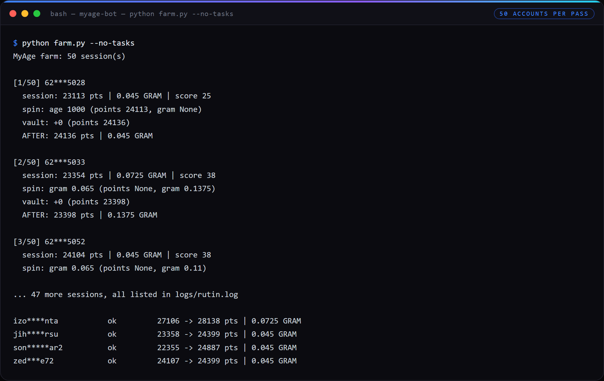
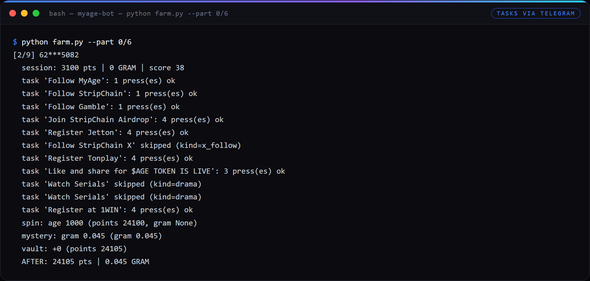

# My Age Bot

**Versi:** 1.1.0 · **Harga:** Rp 95.000 (~$6) · **Kontak pembelian:** [@rmndkyl](https://t.me/rmndkyl)

Bot untuk farming **My Age** (`@MyAgeApp`, https://myageapp.xyz) di banyak akun Telegram sekaligus. Mini app-nya bukan bot chat biasa: aksesnya lewat WebView Telegram, lalu semua aksi dikirim ke REST API `https://myageapp.xyz/api/` dengan header `authorization: tma <initData>`.

## Kebutuhan

| Item | Detail |
|---|---|
| Runtime | Node.js 18+ |
| Wallet | EVM / sesuai chain proyek (kamu sendiri) |
| Proxy | tidak perlu |
| Captcha | tidak perlu |
| Akses | akun proyek yang kamu kelola sendiri |

## Pembayaran

E-Wallet: DANA / GoPay / ShopeePay · Bank: BCA / Seabank · Crypto: contact for wallet address.
Pembeli menghubungi [@rmndkyl](https://t.me/rmndkyl), kirim bukti transfer, lalu terima license key.

---

Bot untuk farming **My Age** (`@MyAgeApp`, https://myageapp.xyz) di banyak akun Telegram sekaligus.
Mini app-nya bukan bot chat biasa: aksesnya lewat WebView Telegram, lalu semua aksi dikirim ke
REST API `https://myageapp.xyz/api/` dengan header `authorization: tma <initData>`.

## Proof it runs

Every screenshot below is re-created from this bot's own log files and snapshot data — not a mockup. Account names and Telegram session ids are masked; the numbers are exactly what the runs produced.

**One snapshot, read back from `data/runs/`: 50 accounts, 50 ok, zero errors, +57,944 points in a single pass.**


**The periodic claim pass over 50 Telegram sessions — spin and vault per account, before/after written to the snapshot. Session ids masked.**



**A 9-account shard pressing tasks end to end: channel joins handled over MTProto, tasks that need an X account skipped honestly instead of faked.**



**Per-account state after the passes above, straight out of `data/state*.json`. Usernames masked.**


---

## Fitur

- **initData otomatis** — `RequestMainWebView` via MTProto, tanpa buka browser/DevTools.
- **Onboarding** — bikin akun di app + klaim *Telegram check* (welcome bonus, 2.000–3.000 AGE).
- **Tasks** — join channel Telegram (via Telethon) lalu press task; task custom di-press 3–4x.
  Task `x_follow`, `drama`, dan `proof` dilewati (butuh akun X / iLoveDrama / screenshot).
- **Klaim berkala** — daily reward, spin (tiap ~4 jam), mystery spin (tiap 2,5 jam, butuh semua
  task step 2 selesai), vault (akumulasi 8 jam).
- **Bot Farm (boss event, baru 14 Nov)** — tiap run bot menghabiskan semua *hit* yang tersimpan
  ke boss yang sedang hidup (`GET /api/boss` → `POST /api/boss {hits}` per 10 hit). Satu hit =
  1 + umur akun + teman (maks +10), dobel saat fase *rage*; charge 1 tiap 5 menit, maksimal 100.
  Bot otomatis **skip** kalau fase *shield* dan umur akun < 3 tahun, berhenti kalau boss mati
  di tengah jalan. Damage dicatat per akun (`rec.boss_damage`) dan totalnya di ringkasan.
- **Achievements** — semua achievement yang sudah selesai diklaim otomatis (`POST /api/achievements
  {key}`); di akun contoh 6 achievement = +4.500 AGE.
- **Story card** — bonus sekali pakai +1.000 AGE (`POST /api/story {to:"story"}`).

- **Opsional** — name tag (`⏳MY AGE APP` di nama, +300/hari) dan bio link (+1.000/hari).
  Dua ini MENGUBAH profil Telegram, default mati.
- **State** — hasil per akun disimpan di `data/state.json`, snapshot per run di `data/runs/`.

## Kebutuhan

| Komponen | Versi / keterangan |
|---|---|
| Python | 3.11+ (di mesin ini: `python`) |
| Paket | `telethon`, `requests`, `tonsdk`, `pynacl` |
| config | `api_id` 2040 + `api_hash` sudah tertanam di `myage/tg.py` (sama dengan tg-airdrop-bot) |

Install paket:

```
pip install telethon requests tonsdk pynacl
```

## Struktur

```
myage-bot/
  farm.py              # runner utama (semua akun / --only / --limit)
  myage/api.py         # client REST myageapp.xyz
  myage/tg.py          # initData via MTProto, join channel, edit profil
  myage/wallet.py      # generate wallet TON v4r2 + ton_proof (belum lolos verifikasi server)
  prejoin.py           # (opsional) join semua channel task tanpa mengerjakan task
  data/state.json      # ringkasan per akun (poin, GRAM, task selesai)
  data/runs/*.json     # snapshot tiap run
  logs/                # log run manual
```

## Pemakaian

```

python farm.py                       # semua akun: tasks + daily + spin + mystery + vault
python farm.py --only andipirdaus59  # satu akun (username)
python farm.py --limit 5             # 5 akun pertama (tes)
python farm.py --no-tasks            # hanya klaim berkala (untuk run rutin)
python farm.py --boss-only           # hanya hit boss Bot Farm (paling ringan)
python farm.py --boss-only --boss-dry  # hitung hit yang tersimpan, tidak dikirim
python farm.py --no-boss             # klaim berkala tanpa ikut boss
python farm.py --tag --bio           # ikut name tag + bio link (ubah profil!)
```

Run rutin yang disarankan: **setiap 30–60 menit** dengan `--no-tasks` (spin 4 jam, mystery 2,5 jam,
vault 8 jam — run lebih sering tidak masalah, bot hanya klaim yang `ready`).

## Reward & timing (terverifikasi 2026-11-10)

| Aksi | Reward | Cooldown |
|---|---|---|
| Telegram check (welcome) | 2.000–3.000 AGE | sekali |
| Tasks | 2.000–3.000 AGE per task (11 task) | sekali |
| Daily | 100–1.000 AGE (streak 7 hari) | 24 jam |
| Spin | 250–5.000 AGE atau 0,035–0,5 GRAM | 4 jam |
| Mystery spin | 0,03–5 GRAM | 2,5 jam |
| Vault | ~20 AGE/jam, max 160 | 8 jam |
| Name tag | +300 AGE | 24 jam |
| Bio link | +1.000 AGE | 24 jam |

Withdraw GRAM minimal **0,5 GRAM** (butuh wallet TON terhubung via TonConnect).

## Troubleshooting

| Gejala | Penyebab / solusi |
|---|---|
| `409 {"error":"Opening your account. Try that again.","reopen":true}` | akun baru dibuka; ulangi request (client sudah retry) |
| `400 Take the Telegram check first` | klaim `/api/welcome` dulu sebelum press task |
| `400 The vault is empty` | vault belum terisi; normal, dilewati |
| `400 No mystery spin yet` | task step 2 belum semua selesai |
| `409 Link your X first` | task follow X butuh akun X terhubung — dilewati |
| `400 iLoveDrama has no account for you` | task Watch Serials butuh akun iLoveDrama — dilewati |
| `session not authorized` | session Telethon mati/2FA; login ulang di tg-airdrop-bot |
| Wallet connect selalu `signature did not pass the check` | lihat bagian Wallet di bawah |

## Wallet (status: BELUM jalan)

`myage/wallet.py` membuat wallet TON v4r2 + menandatangani ton_proof sesuai spec TON Connect.
Server My Age tetap menolak dengan `The wallet signature did not pass the check` untuk wallet
yang belum deploy (kemungkinan verifikasi memakai public key on-chain, bukan stateInit).

Karena withdraw butuh ≥0,5 GRAM, untuk sekarang:
1. Farm dulu sampai saldo GRAM cukup.
2. Buka app di akun tersebut → Wallet → Connect (Tonkeeper/MyTonWallet), import mnemonic dari
   `myage/wallet.py` bila memakai wallet baru, lalu withdraw manual.

## Keamanan

- Session Telegram = akses penuh akun. Jangan commit folder `sessions/`.
- Mnemonic wallet TON yang di-generate harus disimpan di vault, bukan di repo.
- `data/state.json` berisi username + saldo; aman, tanpa kredensial.

## License

`myage/license.py` = port Python dari `license-check.js` LYID:
- owner bypass lewat `data/.owner` (file kosong) atau env `LYID_OWNER=1`,
- selain itu minta License Key, verifikasi `POST http://localhost:3211/verify {key, hwid, script}`,
- cache di `~/.lyid-license`, offline grace 7 hari.